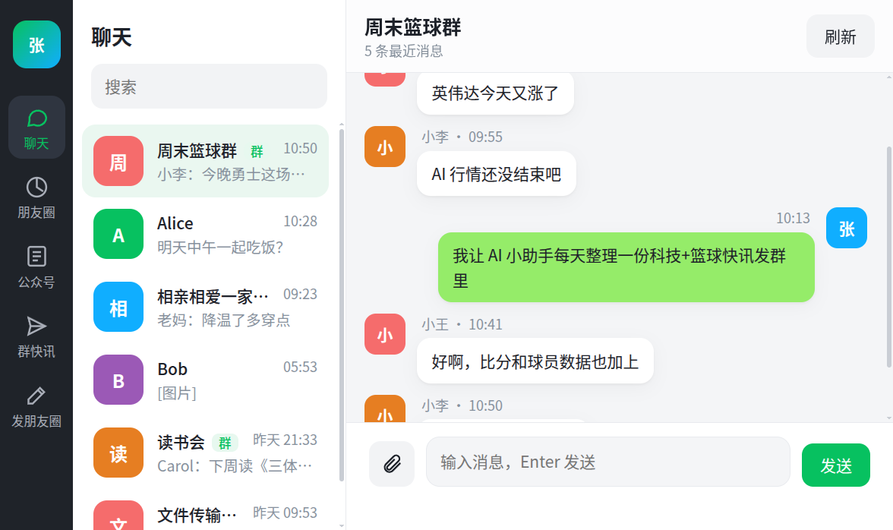
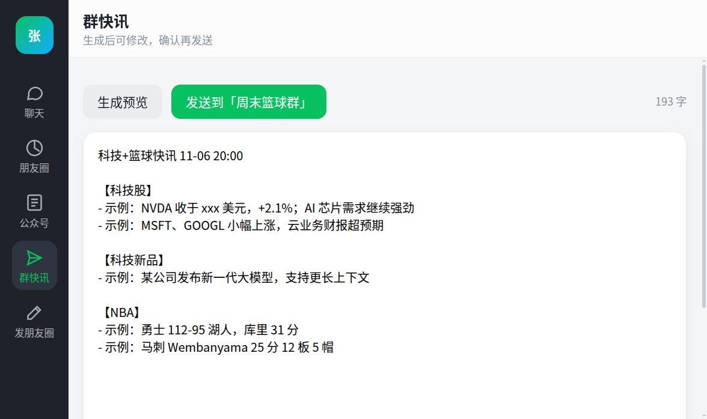
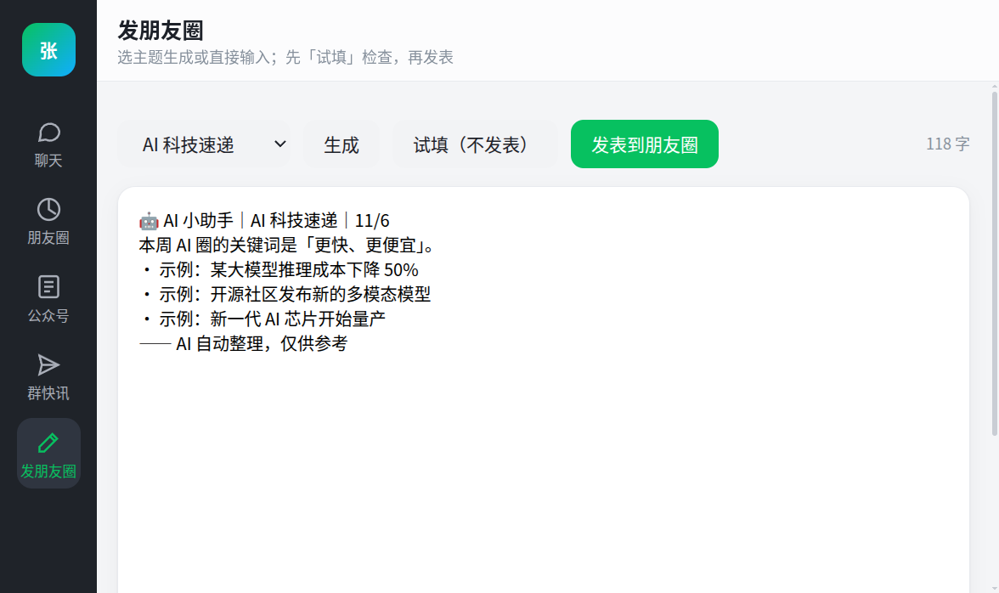
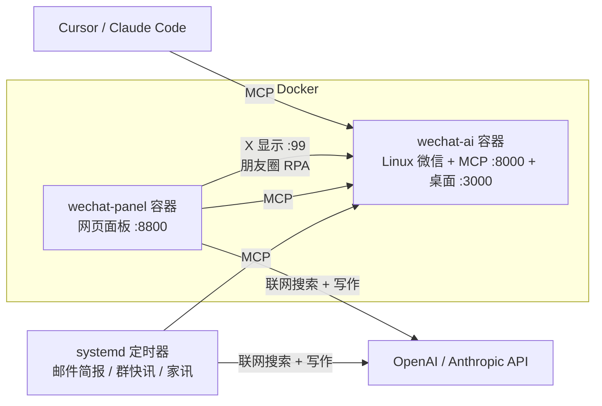

# wechat_building

把自己的微信变成一个「AI 能读、能帮你发」的本地助手：在 Docker 里跑 Linux 版微信（基于 [ChisBread/wechat-ai](https://github.com/ChisBread/wechat-ai)），通过 MCP 让 AI 读取聊天、朋友圈、公众号，再加上一个本地网页面板和几个定时任务。

> Run Linux WeChat in Docker, expose it to AI over MCP, and get a local web panel plus scheduled AI briefings/posts. Everything runs on your own machine.



## 能做什么

| 功能 | 说明 |
| --- | --- |
| 网页面板 | 浏览聊天、朋友圈、公众号；直接发文字、图片、文件 |
| 邮件简报 | 每天两次把新消息、@我、朋友圈、公众号用 AI 总结后发到邮箱 |
| 群快讯 | 参考群聊兴趣，联网搜索写科技股 / 科技新品 / NBA 快讯发到群里 |
| 家庭群家讯 | 以「AI 小助手」身份给爸妈发家乡活动、新闻、健康、理财 |
| 发朋友圈 | AI 生成资讯卡片，先「试填」检查再发表 |
| 接 AI 客户端 | Cursor / Claude Code 等通过 MCP 直接查微信 |

| 群快讯 | 发朋友圈 |
| --- | --- |
|  |  |

截图里的联系人和消息都是虚构的演示数据。



## ⚠️ 风险与免责

- 自动操作微信可能违反腾讯用户协议，**账号有被限制或封禁的风险**，请自行评估，建议用小号试用。
- 发送类功能默认关闭（`WECHAT_AI_MCP_WRITE_ENABLED=false`）；开启后 AI 生成的内容会真的发出去，请先用 `--dry-run` / 面板预览确认。
- 网页面板只监听 `127.0.0.1`；但 wechat-ai 用 host 网络，桌面 `:3000/:3001` 和 MCP `:8000` 会监听所有网卡。请在 `vendor/wechat-ai/.env` 设置 `CUSTOM_USER`/`PASSWORD` 和强随机 `WECHAT_AI_MCP_TOKEN`，并用防火墙挡住局域网访问（例如 `sudo ufw deny 3000,3001,8000/tcp`）。
- `vendor/wechat-ai/config/` 里是你的聊天数据库和密钥，切勿上传或分享。
- 仅供个人学习研究使用。

## 首次准备（仓库不含上游代码）

`vendor/wechat-ai/` 是上游的独立 clone，不在本仓库中；本地改动（host 网络、朋友圈/公众号只读工具）保存在 [patches/wechat-ai-local.patch](patches/wechat-ai-local.patch)，基于上游提交 `2b21ead0d395fd258f806a525f3b2f3c439f4527`。

```bash
git clone https://github.com/ChisBread/wechat-ai.git vendor/wechat-ai
git -C vendor/wechat-ai checkout 2b21ead0d395fd258f806a525f3b2f3c439f4527
git -C vendor/wechat-ai apply ../../patches/wechat-ai-local.patch
cp .env.example .env   # 填入自己的密钥，切勿提交
```

聊天导出（`*_raw.json`、transcript）、截图、日志和所有 `.env` 都已在 `.gitignore` 中排除。

## 一次启动

```bash
./scripts/up.sh
```

首次会 Docker build，可能较久。完成后：

1. 打开 **http://localhost:3000**（或 https://localhost:3001），扫码登录 Linux 微信  
2. 管理台：**http://localhost:8000/dashboard**（账号见 `vendor/wechat-ai/.env`）  
3. 检查：

```bash
./scripts/status.sh
./scripts/agent.sh status
./scripts/agent.sh chats
```

聊天记录导入端口已映射：`8015:8015`。手机与电脑同一 Wi‑Fi；入口一般在：我 → 设置 → 通用 → 聊天记录迁移与备份。

停止：`./scripts/down.sh`

## 个人 CLI（只读）

```bash
./scripts/agent.sh status
./scripts/agent.sh whoami
./scripts/agent.sh contacts 张三
./scripts/agent.sh messages 张三 --limit 20
./scripts/agent.sh search 张三 发票 --limit 20
./scripts/agent.sh summary 工作群
./scripts/agent.sh moments            # 朋友圈：缓存的帖子、新动态提醒、点赞评论
./scripts/agent.sh biz 北美内推鹅      # 公众号推送；不带名字就是全部
./scripts/agent.sh tools
```

朋友圈和公众号走自定义的只读工具 `get_moments` / `get_official_account_messages`
（`vendor/wechat-ai/src/wechat_ai_bot/mcp/feeds.py`）。电脑版微信只存在 GUI 里刷到过的朋友圈，
以及登录期间收到的公众号推送。

## 网页面板

`./scripts/up.sh` 会同时启动独立的面板容器 `wechat-panel`（约 200MB，开机自启），打开 http://127.0.0.1:8800 。
单独重建/重启：`PANEL_UID=$(id -u) PANEL_GID=$(id -g) docker compose up -d --build`；不用容器也可以 `./scripts/ui.sh`。

- 聊天、朋友圈、公众号浏览；聊天里可直接发文字、图片和文件。
- 「群快讯」：生成预览、修改后再发到群里。
- 「发朋友圈」：选主题生成或自己输入；「试填」只填进发表框再取消，确认后再「发表」。

发送需 `WECHAT_AI_MCP_WRITE_ENABLED=true`。面板只监听本机；容器用 host 网络访问 MCP（8000）和微信的 X 显示 `:99`，不挂载 Docker socket。

每次扫码登录后，先在微信里点开任意一个聊天，再把窗口尺寸改一下让机器人重新识别输入框位置：

```bash
docker exec -e DISPLAY=:99 wechat-ai sh -c 'xdotool windowsize $(xdotool search --name "^WeChat$" | tail -1) 1000 1800'
```

## 定时邮件简报

每天 8:00 和 18:00（本机时区）把这段时间的新聊天、@我、朋友圈、公众号用 AI 总结后发到邮箱。

1. 在根目录 `.env` 填 `DIGEST_GMAIL_ADDRESS`、`DIGEST_GMAIL_APP_PASSWORD`（Gmail 应用专用密码）、
   `ANTHROPIC_API_KEY` 或 `OPENAI_API_KEY`，字段见 `.env.example`。
2. 试发：`./scripts/digest.sh --hours 12`（`--dry-run` 只打印不发）。
3. 安装定时：`./scripts/install-digest-timer.sh`（systemd 用户定时器，睡眠/关机错过的会在唤醒后补跑）；日志在 `logs/digest.log`。

AI 失败时邮件退回原始整理；MCP 连不上或微信掉线时邮件会提醒检查。

## 群新闻推送（会真的发消息）

每天 8:00 和 20:00（本机时区）参考 `GROUP_POST_TARGET` 群最近 72 小时聊天，用 OpenAI 联网搜索写一条科技股 / 科技新品 / NBA 快讯发到群里。

1. 需要 `vendor/wechat-ai/.env` 里 `WECHAT_AI_MCP_WRITE_ENABLED=true`，再在 `vendor/wechat-ai` 下 `docker compose up -d`。
2. 预览：`./scripts/group_post.sh --dry-run`；真发：`./scripts/group_post.sh`。
3. 安装定时：`./scripts/install-group-post-timer.sh`；日志在 `logs/group_post.log`。
4. `.env`：`GROUP_POST_TARGET`（必填，群名）、`GROUP_POST_MODEL`（可选，默认 `gpt-5.5`）。

## 家庭群家讯（会真的发消息）

北京时间每天 7:30（早间版）和 19:30（晚间版），以「AI 小助手」身份给家庭群发家乡活动和新鲜事、父亲工作城市的新闻、健康、理财等；遇到中国传统节日、法定节假日、节气会加祝福。

1. 预览：`./scripts/family_post.sh --dry-run`；试发给自己：`./scripts/family_post.sh --to 文件传输助手`；真发：`./scripts/family_post.sh`。
2. 安装定时：`./scripts/install-family-post-timer.sh`；日志在 `logs/family_post.log`。
3. `.env` 配置见下方样本。

## 个人参数（`.env`）

姓名、群名、家乡等都不写在代码里，全部放在根目录 `.env`（已 gitignore）。样本（虚构，按自己情况改）：

```bash
# 邮件简报：用来识别 @我，多个用英文逗号分隔
DIGEST_MY_NAMES=张三,小张

# 朋友群快讯
GROUP_POST_TARGET=周末篮球群

# 家庭群家讯
FAMILY_POST_TARGET=相亲相爱一家人
FAMILY_POST_SON_NAME=小张
FAMILY_POST_HOME=绍兴
FAMILY_POST_WORK_CITY=宁波
FAMILY_POST_COMPANY=某某纺织
# 以下可选
FAMILY_POST_LOCAL_SPOTS=鲁迅故里、沈园、东湖
FAMILY_POST_LOCAL_INDUSTRIES=黄酒、纺织
FAMILY_POST_BOT_NAME=AI 小助手
```

必填项没设置时脚本会直接报错并提示变量名。

## 接到 Cursor

```bash
./scripts/setup-cursor-mcp.sh
```

会生成项目内 `.cursor/mcp.json`（已 gitignore）。重启/重载 Cursor MCP 后即可用。会话规则可用 `prompts/readonly.md`。

MCP 地址：`http://127.0.0.1:8000/mcp`

## VS Code 配置（Google Drive 备份）

`settings.json`、`keybindings.json`、`chatLanguageModels.json` 和插件列表 `extensions.txt` 打包成
Google Drive「我的云端硬盘」里的 `vscode-config.tar.gz`。新机器上下载到 `~/Downloads` 后：

```bash
tar xzf ~/Downloads/vscode-config.tar.gz -C ~
cp ~/vscode-config/*.json ~/.config/Code/User/
xargs -n1 code --install-extension < ~/vscode-config/extensions.txt
```

更新备份：

```bash
rm -rf ~/vscode-config && mkdir -p ~/vscode-config
cp ~/.config/Code/User/{settings,keybindings,chatLanguageModels}.json ~/vscode-config/
code --list-extensions > ~/vscode-config/extensions.txt
tar czf ~/vscode-config.tar.gz -C ~ vscode-config   # 再手动上传覆盖 Drive 上的旧文件
```

## 安全（自己用也建议保持）

| 开关 | 默认 | 作用 |
| --- | --- | --- |
| `WECHAT_AI_MCP_WRITE_ENABLED` | `false` | 真正发消息 / 群操作 |
| `WECHAT_AI_MCP_ADMIN_ENABLED` | `false` | 重置窗口、刷新库等 |

需要发送时，改 `vendor/wechat-ai/.env` 后 `./scripts/up.sh`，并先让 Agent `dry_run=true`，你确认后再真发。

密钥文件：`vendor/wechat-ai/.env`、项目根 `.env`、`.secrets.local` —— 勿提交。

## 目录

```
vendor/wechat-ai/   # 上游运行时（Docker + MCP）
agent/              # CLI、网页面板、简报和推送脚本
panel/              # 网页面板容器
scripts/            # up / down / status / agent / 定时器安装
cursor/             # Cursor MCP 示例
prompts/            # 只读助手提示词
docs/               # 演示截图
```

## 许可与致谢

[GPL-3.0-or-later](LICENSE)。运行时基于 [ChisBread/wechat-ai](https://github.com/ChisBread/wechat-ai)（GPL-3.0），`patches/` 是对其的修改；上游致谢见其 `CREDITS.md`。
